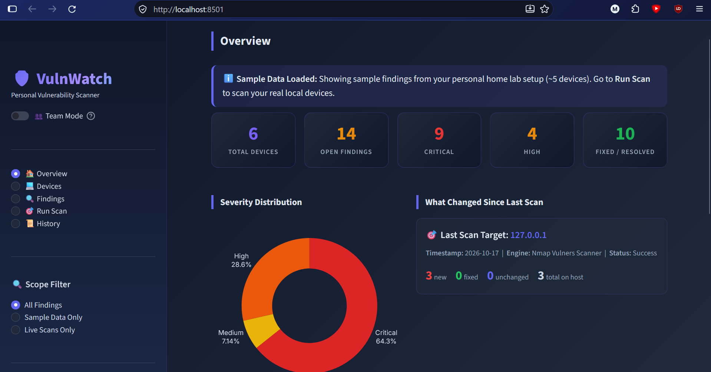
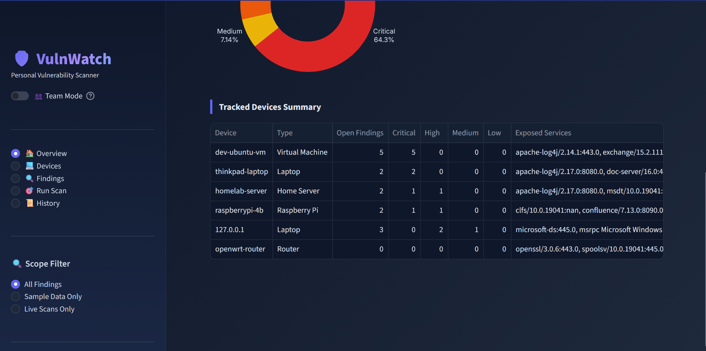
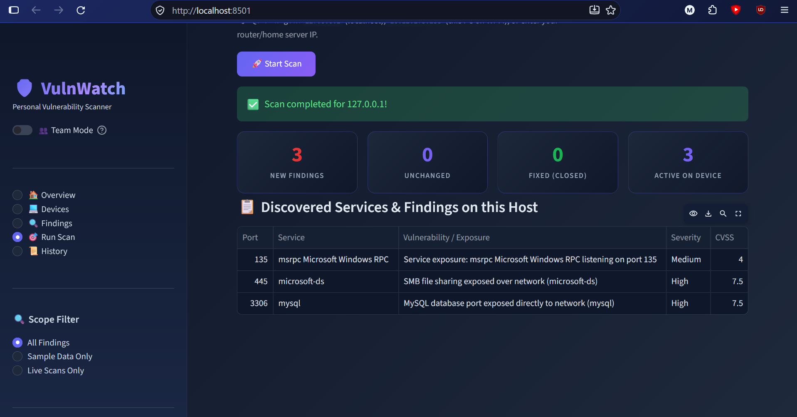
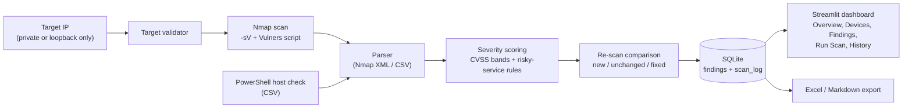

# VulnWatch


**A small vulnerability scanner and tracker for my own machines.**

I wanted to understand how a vulnerability scanner works on a network, so I built one that runs locally. VulnWatch runs Nmap scans, stores what it finds in SQLite, rates each finding by severity, and shows everything in a Streamlit dashboard. When you scan again, it shows what is new, what is unchanged, and what got fixed.

> **Use it only on devices you own or have written permission to test.** VulnWatch refuses public IP addresses by design.

## Screenshots

**Overview**: severity chart and what changed since the last scan. Sample data is labelled in the app.



**Tracked devices**: open findings and exposed services per device (sample data plus one live scan).



**Run Scan**: a live Nmap scan of `127.0.0.1` with the new / unchanged / fixed summary and the services it found.



---

## Features

- **Live Nmap scanning**: service and version detection with the Vulners script to match detected software to known CVEs.
- **Severity rating**: CVSS bands (Critical / High / Medium / Low). Open ports with no CVE (Telnet, FTP, SMB, exposed databases and similar) are rated by a small set of risky-service rules.
- **Re-scan comparison**: each new scan is compared with the previous one and every finding is marked *new*, *unchanged*, or *fixed*. Notes on unchanged findings are kept.
- **Finding status**: mark findings as `Open`, `Fixed`, or `Ignored` (a reason is required for Ignored).
- **Scan history**: every scan is logged with its target, time, and counts.
- **Import**: load results from an Nmap XML file or a CSV file.
- **Windows host check**: a PowerShell script audits a Windows machine (listening ports, risky exposed ports, SMB signing) and exports a CSV the dashboard can import.
- **Export**: download findings as Excel (`.xlsx`) or Markdown.
- **Sample data**: the app loads clearly labelled sample data on first run so the dashboard is not empty. A scope filter switches between all, sample-only, and live-only findings.
- **Optional team mode**: a config flag unlocks owners, remediation deadlines, asset-weighted risk scores, overdue tracking, and NIST CSF / ISO 27001 mapping. See [Team mode](#team-mode-optional).

---

## How it works



## Tech stack

| Area | Tools |
|---|---|
| Language | Python 3.11 |
| UI | Streamlit |
| Charts and data | Plotly, pandas |
| Storage | SQLite |
| Scanning | Nmap (with the Vulners NSE script) |
| Windows audit | PowerShell |
| Export | openpyxl (Excel), Markdown |
| Config | YAML (PyYAML) |
| Testing | pytest |
| Packaging | Docker |

## Project structure

```
vulnwatch/
├── app.py               # Streamlit app (all pages)
├── config.yaml          # team_mode flag
├── requirements.txt
├── Dockerfile
├── core/                # database, scoring, parsers, analytics, exports, demo data, config
├── src/scanners/        # Nmap scanner, target validator, re-scan comparison
├── scripts/             # PowerShell Windows host check
├── samples/             # sample input files
├── tests/               # pytest tests
└── docs/                # documentation and screenshots
```

---

## Setup

### Requirements

- Python 3.11 or newer
- [Nmap](https://nmap.org/download.html), only needed for live scanning. Install it and make sure it is on your `PATH`:
  - Windows: use the installer from nmap.org and tick "add to PATH"
  - Linux: `sudo apt install nmap`
  - macOS: `brew install nmap`

Check that Nmap and the Vulners script work:

```bash
nmap --version
nmap -sV --script vulners 127.0.0.1
```

If the Vulners script is missing, scans still run but return services without CVEs.

### Install and run

```bash
git clone https://github.com/Lucid1o/vulnwatch.git
cd vulnwatch

python -m venv .venv
# Windows:
.venv\Scripts\activate
# Linux / macOS:
source .venv/bin/activate

pip install -r requirements.txt
streamlit run app.py
```

Open http://localhost:8501.

### Docker (dashboard and sample data)

```bash
docker build -t vulnwatch .
docker run -p 8501:8501 vulnwatch
```

The Docker image is for the dashboard and sample data. Live scanning needs Nmap, so run VulnWatch directly on your machine for real scans.

---

## Usage

**Run a scan.** Open **Run Scan**, enter a private IP (for example `127.0.0.1` or `192.168.1.10`), choose a device type, and click **Start Scan**. A summary shows how many findings are new, unchanged, and fixed.

**Scan again later.** Findings that disappeared are marked fixed, new ones are added, and your notes on existing findings are kept.

**Manage findings.** In **Findings**, filter by severity, status, or device, search by CVE or service, and update a finding's status. Ignoring a finding needs a reason.

**Import results.** In **Run Scan → Import Scan File**, upload an Nmap XML file (`nmap -sV -oX scan.xml <target>`) or a CSV with these columns:

```
asset, vulnerability, cve, cvss, service, port, owner, status, asset_criticality, asset_type, notes
```

**Windows host check.** Run the PowerShell script in `scripts/` (`collect_windows_info.ps1`) and import the CSV it creates. Read the script before running it.

```powershell
powershell -ExecutionPolicy Bypass -File scripts\collect_windows_info.ps1
```

**Export.** Download Excel or Markdown from the **Findings** page.

---

## How severity works

**Personal mode (default)** uses the CVSS score directly:

| Severity | CVSS |
|---|---|
| Critical | 9.0 – 10.0 |
| High | 7.0 – 8.9 |
| Medium | 4.0 – 6.9 |
| Low | 0.1 – 3.9 |

Services with no CVE are rated by simple rules, for example Telnet and unauthenticated Redis as Critical, and plain FTP and SMB as High.

### Team mode (optional)

Set `team_mode: true` in `config.yaml` and restart. A toggle appears in the sidebar and these pages are unlocked: Executive Summary, Risk Register, Remediation Tracker, Compliance View, Live Network Scan, Data Ingestion, and Export Reports.

- **Risk score**: CVSS adjusted by asset criticality (High 1.0, Medium 0.75, Low 0.5) into a 0–100 score.
- **Remediation deadlines**: Critical 7 days, High 30, Medium 90, Low 180. Open findings past their deadline are flagged overdue.
- **Compliance view**: findings are mapped to NIST CSF functions and ISO 27001 Annex A controls. It is a mapping aid, not a compliance certification.

Team mode is experimental.

---

## Safety design

1. **Private networks only.** Targets are limited to private ranges (`10.0.0.0/8`, `172.16.0.0/12`, `192.168.0.0/16`) and loopback. Public IPs and domain names are rejected.
2. **No shell.** Nmap is launched with an argument list and `shell=False`, and input containing shell characters or flags is rejected.
3. **Local data.** Everything stays in a local SQLite file (`vuln_dashboard.db`), which is git-ignored.

## Limitations

- Version-based CVE matching can give **false positives**. Linux distributions often patch software without changing its version number.
- Unauthenticated scans only see what a network client sees. They cannot check installed patches or configuration.
- The web UI has **no login**. Keep it on `localhost` or a trusted network.
- Built for personal and lab networks, not for large environments. SQLite and a single-user UI do not scale to a company.
- Team mode scoring is a simplified model. It does not use exploit data such as CISA KEV or EPSS.

## Roadmap

- Authenticated scanning over SSH with package-to-CVE matching (OSV.dev)
- Exploit-likelihood data (CISA KEV, EPSS) in scoring
- Login and roles for multi-user use
- PostgreSQL support
- Ticket export to GitHub Issues or Jira

## License

MIT. See [LICENSE](LICENSE).
