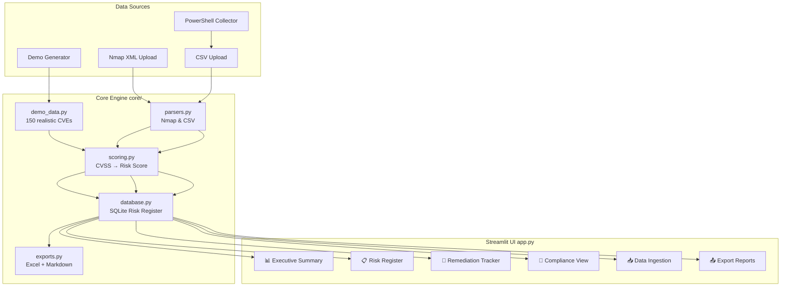

# VulnTrack — Vulnerability & Risk Management Dashboard

> A portfolio-grade, enterprise-style security operations dashboard built with **Python 3.11**, **Streamlit**, **SQLite**, **Pandas**, and **Plotly**. Designed to demonstrate real-world security operations centre (SOC) workflows: vulnerability intake, risk scoring, SLA tracking, compliance mapping, and executive reporting.

---

## Overview

VulnTrack ingests vulnerability scan data (demo, Nmap XML, or CSV), applies a documented CVSS-based risk scoring formula adjusted for asset criticality, stores findings in a local SQLite risk register, and surfaces them through a polished dark-mode dashboard. Analysts can filter/search/edit findings inline, track SLA compliance, map vulnerabilities to NIST CSF and ISO 27001, and export Excel/Markdown reports — all with zero paid services or API keys.

---

## Features

| Feature | Details |
|---------|---------|
| **3 ingestion modes** | Demo (150 realistic CVEs), Nmap -sV XML, generic CSV |
| **Risk scoring** | CVSS → severity → risk score 0-100 (asset-criticality adjusted) |
| **Risk Register** | SQLite-backed, filterable, sortable, inline-editable |
| **Executive Dashboard** | KPIs, severity donut, top-10 risky assets, 6-month trend |
| **Remediation Tracker** | Overdue / due-this-week lists grouped by owner |
| **Compliance View** | NIST CSF function heatmap + ISO 27001 Annex A coverage gauge |
| **Export** | Styled Excel workbook + Markdown management summary |
| **PowerShell Collector** | Windows host assessment → CSV for import |
| **Docker** | One-command container build and run |
| **Tests** | 60 unit tests across scoring, parsers, database, demo data, and reports |
| **Sample Data** | Ready-to-use sample Nmap XML and CSV scan files in `samples/` |

---

## Architecture



---

## Setup & Quickstart

### Prerequisites
- Python 3.11+
- pip

### Install & Run
```bash
git clone https://github.com/<your-username>/vulntrack.git
cd vulntrack

pip install -r requirements.txt
streamlit run app.py
```

Open [http://localhost:8501](http://localhost:8501). Demo data loads automatically.

### Run Tests
```bash
pytest tests/ -v
```

### Docker
```bash
# Build
docker build -t vulntrack .

# Run
docker run -p 8501:8501 vulntrack
```

---

## Risk Scoring Formula

```
Step 1: CVSS Base Score → Severity Bucket + Weight
  9.0–10.0  Critical  weight = 1.00
  7.0–8.9   High      weight = 0.75
  4.0–6.9   Medium    weight = 0.40
  0.1–3.9   Low       weight = 0.15
  0.0       Info      weight = 0.05

Step 2: Asset Criticality Multiplier
  High   → 1.00
  Medium → 0.75
  Low    → 0.50

Step 3: Final Risk Score (0–100)
  risk_score = CVSS × severity_weight × criticality_multiplier × 10
  (clamped to [0, 100])

Example: CVE with CVSS 9.8 on a High-criticality asset
  9.8 × 1.00 × 1.00 × 10 = 98.0
```

### SLA Targets (days from date found)
| Severity | SLA |
|----------|-----|
| Critical | 7 days |
| High | 30 days |
| Medium | 90 days |
| Low | 180 days |

---

## NIST CSF Mapping

| Function | Abbr | Role in VulnTrack |
|----------|------|------------------|
| **Identify** | ID | CVEs that expose asset/config risks (inventory, vuln mgmt) |
| **Protect** | PR | Findings related to access controls, patching, hardening |
| **Detect** | DE | Findings from active scanning / monitoring |
| **Respond** | RS | High-severity, in-progress remediation |
| **Recover** | RC | Post-incident findings (backup, restore capability) |

---

## ISO 27001:2022 Annex A Mapping

| Control | Title | VulnTrack Usage |
|---------|-------|----------------|
| **A.8.8** | Management of technical vulnerabilities | Primary control — most CVEs map here |
| **A.9.2** | User access management | AD/privilege escalation CVEs |
| **A.9.4** | System & application access control | Auth bypass vulnerabilities |
| **A.10.1** | Cryptographic controls | TLS/cipher findings |
| **A.12.6** | Technical vulnerability management | DoS / availability findings |
| **A.16.1** | Management of IS incidents | Actively exploited CVEs |

---

## Deploying on Streamlit Community Cloud

1. Push the repository to GitHub (public or private).
2. Go to [share.streamlit.io](https://share.streamlit.io) → **New App**.
3. Select your repo, branch `main`, main file `app.py`.
4. Click **Deploy**. No secrets needed — the app uses local SQLite.
5. Share the generated `https://<app>.streamlit.app` URL.

> **Note:** Streamlit Community Cloud has ephemeral storage — the SQLite DB resets on restart. For persistent storage, use an external DB (e.g. Supabase free tier) or commit the `.db` file (not recommended for production).

---

## Project Structure

```
vulntrack/
├── app.py                        # Streamlit entry point
├── requirements.txt
├── Dockerfile
├── .streamlit/
│   └── config.toml               # Theme + server config
├── core/
│   ├── __init__.py
│   ├── scoring.py                # CVSS → risk score, SLA, overdue
│   ├── database.py               # SQLite schema + CRUD
│   ├── demo_data.py              # 150-finding demo generator
│   ├── parsers.py                # Nmap XML + CSV parsers
│   └── exports.py                # Excel + Markdown reports
├── samples/
│   ├── sample_nmap_scan.xml      # Realistic Nmap scan file for upload testing
│   └── sample_generic_findings.csv # Realistic CSV export for upload testing
├── tests/
│   ├── __init__.py
│   ├── test_scoring.py           # Scoring and SLA unit tests
│   ├── test_parsers.py           # Nmap and CSV parser unit tests
│   ├── test_database.py          # SQLite persistence and CRUD unit tests
│   ├── test_demo_data.py         # Demo data generation unit tests
│   └── test_exports.py           # Excel and Markdown report unit tests
├── scripts/
│   └── collect_windows_info.ps1  # Windows host assessment
├── docs/
│   └── screenshots/              # Add screenshots here
├── .gitignore
├── LICENSE
└── README.md
```

---

## Limitations

- **SQLite is ephemeral on cloud platforms** — data resets between Streamlit Community Cloud restarts.
- **Nmap CVSS is estimated** — Nmap doesn't output CVSS scores; port/service heuristics are used.
- **No authentication** — this is a portfolio/demo tool; add an auth layer (e.g. `streamlit-authenticator`) before using in production.
- **Demo CVE data** — dates and statuses are randomised for demonstration; not reflective of any real production environment.
- **PDF export** — the Markdown export requires external tooling (e.g. Pandoc) for PDF conversion.

---

## Future Work

- [ ] **Authentication** — integrate `streamlit-authenticator` with LDAP/SSO
- [ ] **Ticket integration** — auto-create Jira/ServiceNow tickets for new Critical findings
- [ ] **Real scanner integrations** — Nessus `.nessus` XML, OpenVAS GMP, Qualys CSV
- [ ] **Email alerting** — SMTP notification for overdue findings
- [ ] **API backend** — FastAPI REST layer for headless integrations
- [ ] **PostgreSQL** — swap SQLite for PostgreSQL for multi-user deployments
- [ ] **CVSS v4.0** — update scoring to support the new CVSS 4.0 vector string format
- [ ] **Asset inventory** — dedicated asset management view with network topology

---

## Screenshots

> Add screenshots to `docs/screenshots/` and reference them here.

**To take screenshots:**
1. Run `streamlit run app.py`
2. Navigate to each page
3. Use your OS screenshot tool or browser's "Save as PDF" 
4. Save to `docs/screenshots/<page-name>.png`

```markdown


```

---

## License

MIT — see [LICENSE](LICENSE).
