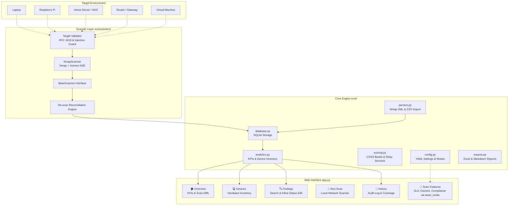

# VulnWatch — Personal Vulnerability Scanner & Tracker

I built VulnWatch to scan and track vulnerabilities on my own devices and home lab. It provides a local, private, and lightweight way to discover open ports, correlate detected service versions with known CVEs, and track remediation across my home machines over time. Enterprise-style collaboration features are also available behind an optional team mode.

---

## Features

- **Live Local Network Scanning**: Leverages Nmap with Vulners NSE script integration to scan private IP addresses and correlate banners with CVEs.
- **Re-scan Reconciliation**: Automatically detects when vulnerabilities are resolved (closed ports are marked Fixed), adds newly discovered issues, and preserves notes on unchanged findings.
- **Device-Centric Tracking**: Dedicated device view for personal hardware (laptops, Raspberry Pis, home servers, routers, and VMs).
- **Personal-Mode Scoring**: Severity is determined directly from CVSS bands and predefined risky-service rules, with no artificial corporate asset weighting.
- **Simplified Status Flow**: Track findings as `Open`, `Fixed`, or `Ignored` (with a required justification note).
- **Extensible Scanner Architecture**: Scanners inherit from a modular `BaseScanner` interface, making it easy to add authenticated SSH scanning or container image audits.
- **Zero Cloud Dependencies**: Runs entirely offline on localhost with local SQLite persistence; no paid API keys or external services required.
- **Reporting & Exports**: Export findings to Excel workbooks or Markdown summaries directly from the dashboard.
- **Optional Team Mode**: Toggle `team_mode: true` in `config.yaml` to unlock enterprise features such as SLA tracking, owner assignment, compliance mapping (NIST CSF & ISO 27001), and management summaries.

---

## Architecture



---

## Setup

### Prerequisites

- **Python**: 3.11 or higher
- **Nmap** (Optional, for live network scanning): Installed and available in PATH (or standard Windows install path `C:\Program Files (x86)\Nmap`).

### Local Installation

1. **Clone the repository:**
   ```bash
   git clone https://github.com/your-username/vulnwatch.git
   cd vulnwatch
   ```

2. **Create a virtual environment:**
   ```bash
   python -m venv .venv
   # On Windows:
   .venv\Scripts\activate
   # On Linux / macOS:
   source .venv/bin/activate
   ```

3. **Install dependencies:**
   ```bash
   pip install -r requirements.txt
   ```

4. **Launch the application:**
   ```bash
   streamlit run app.py
   ```
   Open your browser at `http://localhost:8501`.

### Docker Setup

Run VulnWatch in a self-contained container:

```bash
docker build -t vulnwatch .
docker run -p 8501:8501 vulnwatch
```

---

## Usage

### 1. Overview
View total tracked devices, open vulnerabilities, critical/high counts, severity breakdown, and what changed since your last scan.

### 2. My Devices
Inspect each device on your home network (e.g. `thinkpad-laptop`, `raspberrypi-4b`, `homelab-server`), view its open ports and services, and drill down into active findings.

### 3. Managing Findings
Filter findings by severity, status (`Open`, `Fixed`, `Ignored`), or device. Update finding status inline; when marking a finding as `Ignored`, enter a reason (e.g., test service isolated on local lab VLAN).

### 4. Running a Live Scan
Enter a private IP (e.g. `192.168.1.1` or `127.0.0.1`) and select a device label. VulnWatch runs an authorized Nmap scan with service banner grabbing and Vulners NSE script correlation. The re-scan engine automatically updates findings: closed ports are marked Fixed, newly detected exposures are added, and unchanged items preserve past notes.

### 5. Enabling Team Mode
To experiment with enterprise-style features:
1. Open `config.yaml`
2. Change `team_mode: false` to `team_mode: true`
3. Restart or reload the app. A toggle will appear in the sidebar to switch between personal and team workflows.

---

## How Severity Works

### Personal Mode (Default)
In personal mode, severity is assigned objectively without business-criticality multipliers:
- **CVSS 3.x Score Bands**:
  - **Critical**: 9.0 – 10.0
  - **High**: 7.0 – 8.9
  - **Medium**: 4.0 – 6.9
  - **Low**: 0.1 – 3.9
  - **Informational**: 0.0
- **Risky Service Rules**: Common exposed services without explicit CVEs are mapped based on protocol safety (e.g., Telnet on port 23 and unauthenticated Redis on port 6379 are flagged as Critical; unencrypted FTP on port 21 and SMB on port 445 are flagged as High).

### Team Mode (Optional)
When team mode is enabled in `config.yaml`, findings can be adjusted by asset criticality multipliers (`High`: 1.0, `Medium`: 0.75, `Low`: 0.50) into a 0–100 composite risk score with SLA deadlines (`Critical`: 7 days, `High`: 30 days, `Medium`: 90 days, `Low`: 180 days).

---

## Safety Design

VulnWatch is designed specifically for scanning personal machines and home labs with built-in safeguards:

1. **Strict Private IP Boundary**: Target validation strictly enforces RFC 1918 private subnets (`10.0.0.0/8`, `172.16.0.0/12`, `192.168.0.0/16`) and loopback (`127.0.0.1`). Public IPs, external domain names, and cloud addresses are blocked to prevent unauthorized scanning.
2. **Zero Shell Injection**: The scanner executes the Nmap binary directly using parameter lists (`subprocess.run(["nmap", ...], shell=False)`). Shell chaining characters (`;`, `&&`, `|`, `` ` ``), redirection, and flag injections are strictly rejected by the validator.
3. **Local Execution**: Scan data and risk register remain strictly on your machine in a local SQLite database (`vuln_dashboard.db`).

---

## Limitations

- **Version-Based CVE Matching**: Nmap Vulners matches CVEs based on software version banners reported by listening services. It does not perform active exploitation, so backported security patches (common in Debian/Ubuntu packages) may result in false positives.
- **Local Network Scope**: The tool is designed for personal and home lab networks; it cannot and should not be used across the public Internet.
- **Authentication**: The local web UI runs without user authentication by default; keep the web port bound to `localhost` or access it over a secure local VPN (like WireGuard/Tailscale).

---

## Roadmap

Planned future enhancements:
- **Authenticated SSH Scanning**: Audit Linux machines and Raspberry Pis internally over SSH for installed package CVEs (deb/rpm) and configuration weaknesses.
- **Owners and Remediation Deadlines**: Assign tasks to team members with automated SLA reminders (currently available behind `team_mode`, experimental).
- **Asset Criticality & Weighted Risk Scoring**: Customize weighting based on environment impact (currently available behind `team_mode`, experimental).
- **Compliance Mapping**: Map findings to frameworks like NIST CSF and ISO 27001 (currently available behind `team_mode`, experimental).
- **Multi-User Access & Authentication**: Role-based access control (RBAC) with local credentials or SSO.
- **PostgreSQL Support**: Database migration from SQLite for larger multi-node environments.
- **Ticketing Integration**: Export or synchronize findings directly with GitHub Issues or Jira.

---

## License

MIT License. See [LICENSE](LICENSE) for details.
